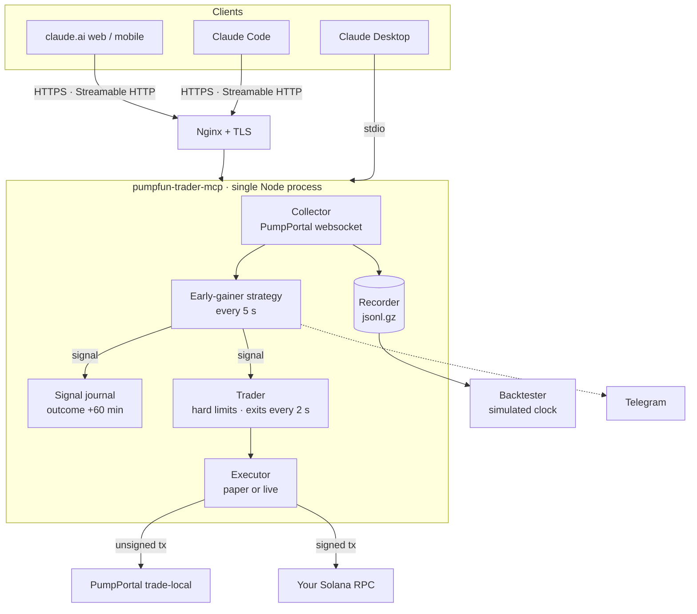

<div align="center">

# 🚀 pumpfun-trader-mcp

**A Model Context Protocol server that watches every pump.fun launch, detects early volume surges,
backtests itself on recorded market data, and trades through your own Solana wallet, all from a chat with Claude.**


</div>

> [!WARNING]
> **Experimental software that can spend real money.** The strategy detects *current* volume
> surges; it doesn't predict prices. Most pump.fun tokens go to zero. Backtests are optimistic.
> It defaults to **paper mode**. Read [`docs/LIVE-TRADING.md`](docs/LIVE-TRADING.md) before
> enabling live trading, and never fund the bot wallet with more than you can lose. Not financial advice.

---

## Contents

- [Features](#features)
- [How it works](#how-it-works)
- [Quick start](#quick-start)
- [Talking to it](#talking-to-it)
- [MCP tools](#mcp-tools)
- [Strategy at a glance](#strategy-at-a-glance)
- [Backtesting](#backtesting)
- [Risk controls](#risk-controls)
- [Documentation](#documentation)
- [Project structure](#project-structure)
- [Roadmap](#roadmap)
- [License](#license)

## Features

- 📡 **Real-time pump.fun stream.** Every launch, trade and graduation comes through one PumpPortal
  websocket, with auto-subscribe, reconnect and pruning.
- 🔥 **Early-gainer strategy.** It looks for relative-volume surges vs each token's own baseline, bursts of
  *new* buyer wallets, buy pressure, breakouts and holder growth, after rug, wash-trading and
  concentration filters.
- 📓 **Signal journal.** Every signal's outcome (peak, drawdown, +5/+15/+60 min) is tracked
  automatically, so you can see whether the strategy works before risking money.
- ⏪ **Replay backtester.** It records the raw stream and replays it through *the same code* on a
  simulated clock, with entry delay, fees, slippage, limits and exits. Includes parameter sweeps.
- 💸 **Trading.** Buy and sell via the PumpPortal Local Transaction API, **signed locally**, sent through your
  own RPC, with confirmations parsed for real fills.
- 🛡️ **Server-side hard limits.** Per-trade, per-day, open positions, wallet reserve, slippage cap,
  re-buy cooldown, kill switch.
- 🎯 **Automatic exits.** Take profit (partial), stop loss, trailing stop, max hold, exit when the creator sells.
- 🤖 **Optional auto-trading**, gated twice: by env, and by an explicit tool call.
- 🌐 **Runs anywhere.** Claude Desktop (stdio), Claude Code, or **claude.ai web and mobile** via a
  hosted HTTPS endpoint. A one-shot VPS setup script is included.
- 🔔 **Telegram alerts** for signals, fills and the kill switch.

## How it works



## Quick start

**Requirements:** Node.js ≥ 20.6.

```bash
git clone https://github.com/YOUR_USERNAME/pumpfun-trader-mcp.git
cd pumpfun-trader-mcp
npm install
npm run build
cp .env.example .env
```

Edit `.env`, setting at least:

```env
MCP_SECRET=<output of: npm run gen-secret>
DATA_DIR=/absolute/path/to/pumpfun-trader-mcp/data
```

Then choose how to run it:

| Option | Command / setup | Guide |
|---|---|---|
| **Claude Desktop** (local) | Add `dist/stdio.js` to `claude_desktop_config.json` | [Deployment → Claude Desktop](docs/DEPLOYMENT.md#claude-desktop-stdio) |
| **Local HTTP** (Claude Code, Inspector) | `node --env-file=.env dist/http.js` | [Deployment → Local HTTP](docs/DEPLOYMENT.md#local-http) |
| **VPS, 24/7** (claude.ai web and mobile) | `sudo bash deploy/setup-vps.sh pump.example.com you@mail.com` | [Deployment → VPS](docs/DEPLOYMENT.md#vps-hostinger) |

Give it ~10 minutes after starting to build up stream history.

> [!IMPORTANT]
> Keep `@solana/web3.js` on v1. **Don't run `npm audit fix --force`**: it upgrades to v3 and breaks the build.

## Talking to it

```text
Check scanner status and trading status.
Show early gainers, including near misses.
Evaluate <mint> with the early-gainer strategy and explain every failed gate.
How has the strategy performed over the last 3 days? Should I go live?
Run a backtest on the last 48 hours, ignoring limits. Then again with STOP_LOSS_PCT=20.
Buy 0.02 SOL of <mint>.  ·  Show my positions.  ·  Sell 50% of <symbol>.
Turn auto-trading on.  ·  Kill switch on and sell everything.
```

## MCP tools

<details>
<summary><b>23 tools</b> (click to expand)</summary>

| Group | Tool | Purpose |
|---|---|---|
| Scanner | `scanner_status` | Stream health, tokens tracked, uptime |
| | `get_momentum_leaders` | Generic 0–100 momentum/health ranking |
| | `get_token_signals` | Full metrics and risk flags for one mint |
| | `get_new_tokens` | Latest launches |
| | `get_recent_migrations` | Latest bonding-curve graduations |
| | `watch_token` / `unwatch_token` | Pin a mint so it's never pruned |
| | `rugcheck_token` | RugCheck.xyz summary |
| | `get_token_metadata` | Description, image, socials |
| Strategy | `get_early_gainers` | Tokens triggering the strategy now (plus near misses) |
| | `evaluate_early_gainer` | Every metric, score component and failed gate for one mint |
| | `get_strategy_performance` | Journal stats: hit rates, stop-first rate, simulated P&L |
| | `get_signal_journal` | Recent signals and outcomes |
| | `get_strategy_config` | Current `EG_*` thresholds |
| | `run_backtest` | Replay recorded data with optional overrides |
| Trading | `trading_status` | Mode, wallet, balance, limits, P&L today |
| | `buy_token` / `sell_token` | Manual trades (limits enforced) |
| | `get_positions` / `get_trade_history` | Open positions with live P&L; fills |
| | `set_exit_rules` | Per position or defaults |
| | `set_auto_trading` | On/off (needs `AUTO_TRADE_ALLOWED=true`) |
| | `kill_switch` | Block buys; optionally sell everything |

</details>

## Strategy at a glance

A signal fires when **all gates pass** and the **score ≥ 65**:

| Gate (2-minute window) | Default |
|---|---|
| Volume vs the token's own baseline | ≥ **3×**, and ≥ 3 SOL |
| Unique buyers / new buyer wallets | ≥ **8** / ≥ **5** |
| Buy pressure | ≥ **60%** of volume, net inflow |
| Market cap / age | 35–400 SOL / 3–240 min |
| Top-10 holders, wash trading, creator sold, rug flags | must be clean |

The score adds relative volume, absolute volume, new-wallet growth, breakout, holder growth, buy
pressure, big buyers and socials. Full details: [`docs/STRATEGY.md`](docs/STRATEGY.md).

## Backtesting

```bash
# 1. let the server record the live stream for 48–72 h (RECORD_STREAM=true, the default)
# 2. replay it
npm run backtest
npm run backtest -- --entry-delay 8000 --set STOP_LOSS_PCT=20
npm run backtest -- --sweep EG_MIN_REL_VOL=2,3,5 --sweep STOP_LOSS_PCT=20,30,40
```

Each run writes a Markdown and JSON report to `backtest-results/`. Example (from a **synthetic** smoke-test dataset; the numbers are meaningless):

```text
| Signals | 148 | Trades | 148 | Win rate | 78.4% | Average trade | 76.1% | Profit factor | 22.5 |
```

Real pump.fun data will look far worse. That's what the backtester is for. See
[`docs/BACKTESTING.md`](docs/BACKTESTING.md) for methodology, realism limits and how to avoid overfitting.

## Risk controls

| Control | Env | Default |
|---|---|---|
| Max SOL per trade | `MAX_SOL_PER_TRADE` | 0.05 |
| Max SOL per UTC day | `MAX_DAILY_SOL` | 0.25 |
| Max open positions | `MAX_OPEN_POSITIONS` | 3 |
| SOL always left in wallet | `MIN_WALLET_RESERVE_SOL` | 0.05 |
| Slippage cap | `MAX_SLIPPAGE_PCT` | 25% |
| Re-buy cooldown | `REBUY_COOLDOWN_MINUTES` | 60 |
| Stop loss / take profit / trailing | `STOP_LOSS_PCT` / `TAKE_PROFIT_PCT` / `TRAILING_STOP_PCT` | 30 / 100 (sell 50%) / 25 |
| Max hold | `MAX_HOLD_MINUTES` | 60 |

The limits are read from env only. Claude can tighten exits and flip the kill switch, but it can't raise limits.

## Documentation

| Doc | What's inside |
|---|---|
| [STRATEGY.md](docs/STRATEGY.md) | Gates, score, exits, known weaknesses |
| [BACKTESTING.md](docs/BACKTESTING.md) | Recording, replay, sweeps, reading reports, realism |
| [DEPLOYMENT.md](docs/DEPLOYMENT.md) | Claude Desktop, local HTTP, Hostinger VPS, operations |
| [LIVE-TRADING.md](docs/LIVE-TRADING.md) | Go-live gate, preflight, emergency procedures, costs |
| [CONFIGURATION.md](docs/CONFIGURATION.md) | Every environment variable |
| [SECURITY.md](SECURITY.md) | Secrets, guarantees, recommendations |
| [CHANGELOG.md](CHANGELOG.md) | Version history |

## Project structure

```text
src/
├── http.ts          Hosted entry: Express + Streamable HTTP, auth, rate limit, /health
├── stdio.ts         Local entry for Claude Desktop / Code
├── tools.ts         All MCP tool definitions
├── engine.ts        Wires collector → strategy → journal / trader / Telegram
├── collector.ts     PumpPortal websocket, token state, pins, pruning
├── recorder.ts      Raw stream → hourly jsonl.gz
├── scoring.ts       Generic momentum score and risk flags
├── strategy.ts      Early-gainer volume-surge strategy
├── journal.ts       Signal outcomes and performance stats
├── trader.ts        Risk checks, positions, exits, auto-trading
├── executor.ts      Live (sign, send, confirm, parse fills) and paper executors
├── backtest.ts      Replay engine, reports, parameter sweeps
├── preflight.ts     Live-mode checks (never signs or sends)
├── clock.ts         Real or simulated time
├── store.ts         Atomic JSON persistence
├── alerts.ts · price.ts · config.ts · types.ts
scripts/make-synthetic-recording.mjs   Synthetic data for smoke tests and CI
deploy/              setup-vps.sh · ecosystem.config.cjs (PM2) · nginx-pumpfun-mcp.conf
docs/                Strategy, backtesting, deployment, live trading, configuration
```

### npm scripts

| Script | Does |
|---|---|
| `npm run build` | Compile TypeScript to `dist/` |
| `npm start` | Start the HTTP server |
| `npm run start:stdio` | Start the stdio server |
| `npm run gen-secret` | Print a random 64-hex secret |
| `npm run preflight -- <mint>` | Live-mode checks |
| `npm run backtest -- [...]` | Replay recordings |
| `npm run backtest:synthetic` | Generate synthetic data and backtest it (smoke test) |

## Roadmap

- [ ] Wallet funding-source analysis (detect coordinated "new wallets")
- [ ] Historical data import (Bitquery / Dune) so you can backtest without recording first
- [ ] Post-graduation (PumpSwap) volume baseline
- [ ] Web dashboard for journal and positions
- [ ] Jito bundle submission for faster fills

## Contributing

PRs are welcome. See [CONTRIBUTING.md](CONTRIBUTING.md). Strategy changes should include a
backtest comparison on real recordings.

## Acknowledgements

- [PumpPortal](https://pumpportal.fun) for the data stream and transaction API (third-party, unofficial)
- [Model Context Protocol](https://modelcontextprotocol.io) TypeScript SDK
- [RugCheck](https://rugcheck.xyz) for the token risk reports

## License

[MIT](LICENSE). Provided as-is, without warranty. You alone are responsible for any trades it makes.
