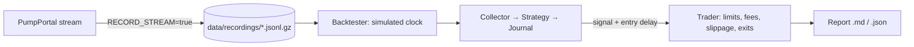

# Backtesting

pump.fun has no public historical tick API, so the server **records the live stream** and the
backtester **replays those recordings** through the exact same code that trades live:

- collector
- early-gainer strategy
- signal journal
- risk limits
- exit loop

Everything runs on a simulated clock, so every 2-minute window, cooldown and max-hold timer
behaves exactly as it would live.



## 1. Record

Recording is on by default (`RECORD_STREAM=true`). Files are hourly gzip JSONL:

```
data/recordings/2026-10-13T14.jsonl.gz      {"ts":1760364000123,"m":{...raw PumpPortal message...}}
```

Expect roughly 0.3–1 GB per day compressed. Old files are deleted after `RECORD_KEEP_DAYS` (default 7).

**How much data?** You need at least **48–72 hours**, covering different times of day and weekdays.
pump.fun activity varies a lot between US and Asian hours.

Only tokens the collector is tracking have their trades recorded. That covers every new launch
until it goes idle (`DEAD_AFTER_SECONDS`) or exceeds `TRACK_MAX_MINUTES`, so late revivals of old
tokens are missing.

## 2. Run

```bash
npm run build
npm run backtest                                   # all recordings in data/recordings
npm run backtest -- --from 2026-10-12T00:00:00Z --to 2026-10-13T00:00:00Z
npm run backtest -- --set STOP_LOSS_PCT=20 --set EG_MIN_REL_VOL=4
npm run backtest -- --entry-delay 8000             # pessimistic: you get in 8 s after the signal
```

Each run writes `backtest-results/backtest-<time>.md` and `.json`.

Or ask Claude: *"Run a backtest on the last 48 hours, ignoring limits"* (`run_backtest` tool).

### Options

| Flag | Default | Meaning |
|---|---|---|
| `--data` | `data/recordings` | Folder or single file |
| `--from` / `--to` | all | ISO time range |
| `--set KEY=VAL` | — | Override any env setting for this run (repeatable) |
| `--sweep KEY=a,b,c` | — | Grid search, combined across all `--sweep` flags (≤ 300 combinations, run in parallel) |
| `--entry-delay` | 3000 | ms between signal and fill |
| `--out` | `backtest-results` | Output folder |

To measure the **strategy itself** rather than your risk limits, lift the limits for that run:

```bash
npm run backtest -- --set MAX_DAILY_SOL=100000 --set MAX_OPEN_POSITIONS=1000 --set PAPER_STARTING_SOL=100000
```

## 3. Sweep (parameter search)

```bash
npm run backtest -- \
  --set MAX_DAILY_SOL=100000 --set MAX_OPEN_POSITIONS=1000 --set PAPER_STARTING_SOL=100000 \
  --sweep EG_MIN_REL_VOL=2,3,5 \
  --sweep EG_MIN_NEW_BUYERS_2M=3,5,10 \
  --sweep STOP_LOSS_PCT=20,30,40
```

This produces `backtest-results/sweep-<time>.md`: a table ranked by total P&L, with win rate,
average trade, profit factor and max drawdown.

### Avoid overfitting

1. Split your data: sweep on days 1–3, then run the winning settings **once** on days 4–5.
2. Prefer settings that are good across a *range* of values over a single sharp peak.
3. Be suspicious of any result that depends on a handful of huge winners. Check `bestTradePct`
   against the median.

## 4. Read the report

| Metric | What to look for |
|---|---|
| Signals vs trades | If most signals aren't traded, your limits decide the result more than the strategy does |
| Win rate | Can be low (30–40%) and still profitable if wins are large |
| Average trade % | **After** simulated fees and slippage. Must be clearly positive |
| Profit factor | Gross wins ÷ gross losses. Below 1.2 is noise, above 1.5 is interesting |
| Max drawdown | The worst losing streak in SOL. Size so you could survive 3× this |
| Exit reasons | Lots of `stop loss` means entries are late. Lots of `max hold` means signals don't move |
| Journal: stop loss before peak | High means the price dips before running, so the stop is too tight or entries are early |
| Journal: never above entry | Share of signals that went straight down |

## 5. How realistic is it?

| Modelled | Not modelled |
|---|---|
| Entry delay after signal | Failed or dropped transactions |
| Fees (`PAPER_FEE_PCT`, default 1.5%/side) | Priority-fee bidding wars |
| Price impact (`PAPER_IMPACT_PCT`, default 3%/side) | Your own order moving the curve more than that on tiny caps |
| All hard limits, cooldowns, exits | Exits are checked every 2 s; real sells also take seconds to confirm |
| Exact stream timing | Events missed by the live recorder (disconnects) |

**Treat backtest results as an upper bound.** A marginal backtest is a losing live strategy.

## Synthetic data (smoke test only)

```bash
npm run backtest:synthetic
```

This generates 6 hours of made-up data from simple token archetypes (duds, rugs, pump-and-dumps,
runners) and runs the backtester on it. Reports on synthetic data carry a warning banner. **The
numbers mean nothing about real markets**: the generator's runners are designed to run. Use it to
check that the pipeline works (CI does exactly this).
